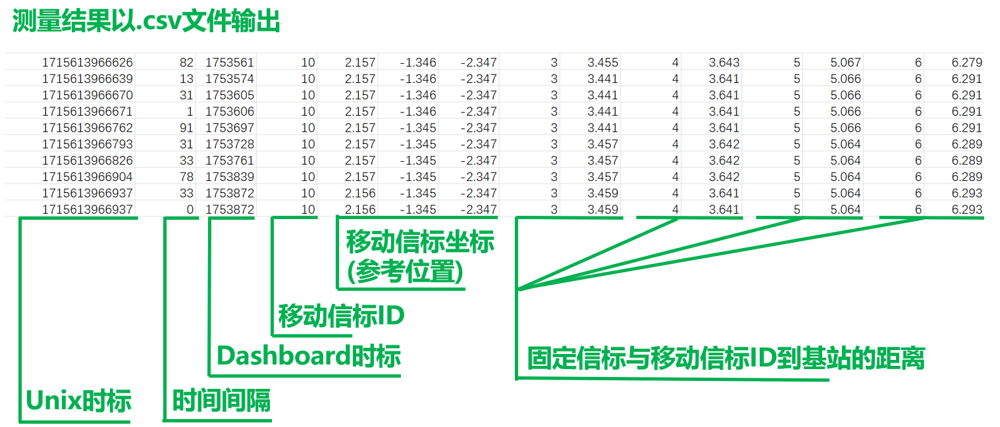

# 数据说明

## 2024_09_20__115543__Marvelmind_log.csv

原始数据

## base-station-location.txt

| 列号 | 描述 |
| --- | --- |
| 1 | 基站编号 |
| 2-3 | x、y，单位：m |
| 4 | z，单位：m |

## range.txt

| 列号 | 描述 |
| --- | --- |
| 1 | 时间，单位：秒 |
| 2-5 | 距离，单位米，分别相对基站3、4、5、6 |

## ref_pos.txt

| 列号 | 描述 |
| --- | --- |
| 1 | 时间，单位：秒 |
| 2-4 | 参考位置，单位米 |
